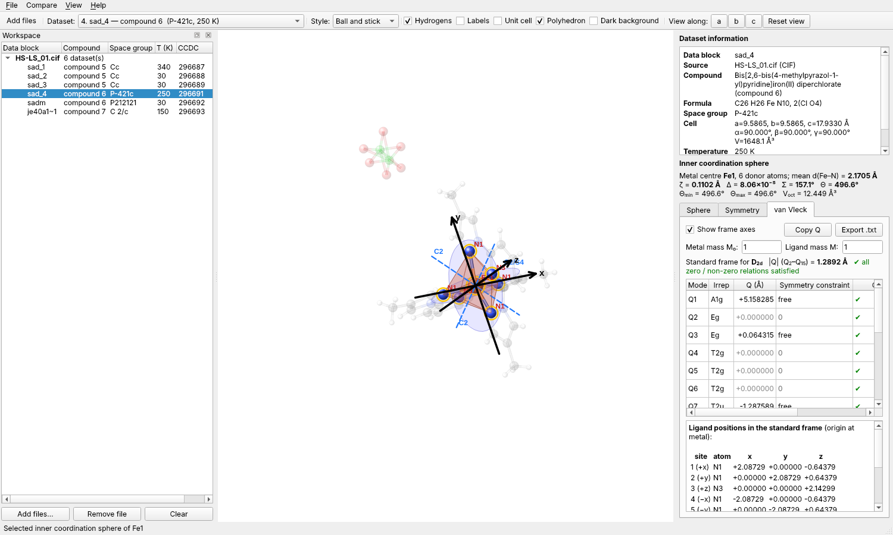
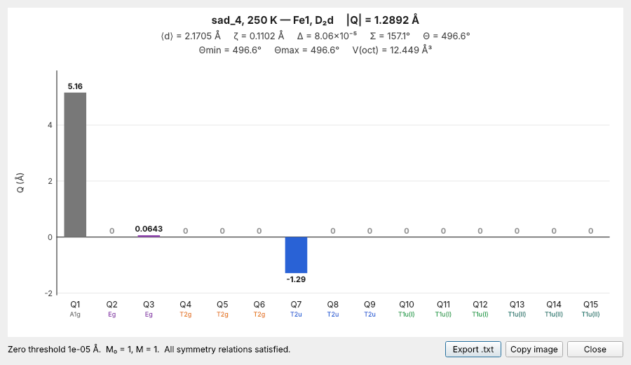
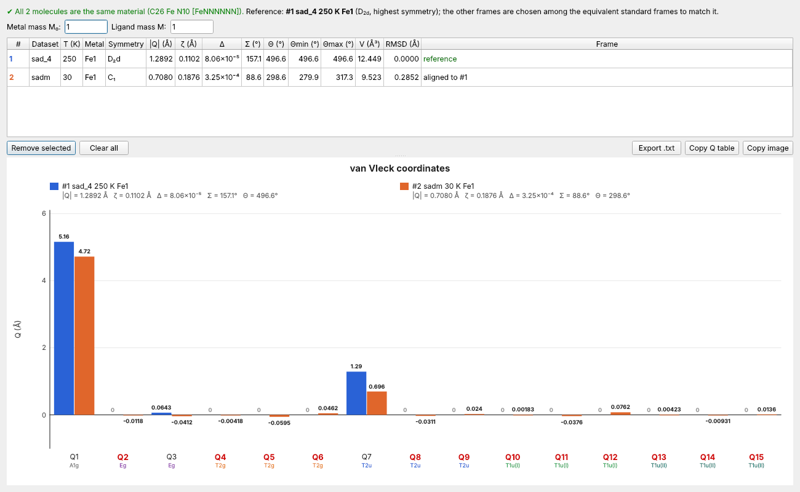

# vanVleck

**Point-group symmetry and van Vleck coordinates of pseudo-octahedral ML₆ complexes from crystal structures.**

vanVleck is a desktop program (Python + PySide6) for spin-crossover and other pseudo-octahedral
coordination compounds. It reads CIF and XYZ files, lets you click a complex, determines the
point group of its inner coordination sphere (the metal and its six donor atoms), places that
sphere in a symmetry-adapted standard frame, and computes the 15 van Vleck coordinates Q₁–Q₁₅
together with OctaDist-type distortion parameters.



## Features

- Reads `.cif` files (several data blocks) and `.xyz` files (several frames); expands the asymmetric
  unit with the symmetry operators and grows complete molecules, as in Mercury.
- Multi-file workspace, 3D viewer (ball-and-stick, sticks, wireframe, spacefill), unit cell,
  view along a/b/c.
- Point group of the ML₆ sphere at a user-defined tolerance (default 1×10⁻⁵ Å), with the variants
  D₂ₕᵈ/D₂ₕᵛ, C₂ᵥᵈ/C₂ᵥᵛ, C₂ᶻ/C₂ˣʸ and Cₛᶻ/Cₛˣʸ̄; symmetry axes and mirror planes are drawn in 3D;
  pseudo-symmetry is reported at larger tolerances.
- Symmetry-adapted standard frame and van Vleck coordinates Q₁–Q₁₅, |Q|, and an automatic check
  that every Q required by symmetry to be zero, equal or opposite actually is.
- Distortion parameters ⟨d⟩, ζ, Δ, Σ, Θ, Θ_min, Θ_max and octahedral volume.
- Compare window: molecules of the same material are placed in consistent frames, with RMSD to the
  reference and a grouped bar chart; Qs that vanish in one structure but not in the other are
  highlighted.
- Export of Q₁–Q₁₅ and |Q| as tab-separated text.

| Q bar chart | Compare |
| --- | --- |
|  |  |

## Installation

**Windows executable.** Download `vanVleck.exe` from the
[Releases](https://github.com/ShuangYuan1996/vanVleck/releases) page and double-click it.
No Python installation is needed.

**From source** (Windows, macOS, Linux; Python ≥ 3.10):

```bash
git clone https://github.com/ShuangYuan1996/vanVleck.git
cd vanVleck
pip install -r requirements.txt
python main.py                       # or: python main.py file1.cif file2.xyz
```

On Windows, `run.bat` starts the program from source and `build_exe.bat` builds `vanVleck.exe`
with PyInstaller.

## Quick start

1. Open one or more structure files with **Add files…** or drag them onto the window.
   `examples/synthetic_FeN6.xyz` contains one FeN₆ sphere for each of the 19 standard point groups.
2. Choose a data block in the **Workspace** tree and click any atom of a complex.
3. The **Sphere** tab lists the metal and donor atoms; the **Symmetry** tab gives the point group and
   symmetry elements; the **van Vleck** tab gives the standard frame, Q₁–Q₁₅, |Q| and the symmetry
   check. A bar chart of Q opens in a separate window.
4. Click **Compare** in the menu bar, then click complexes in any data block or file to compare them.

Mouse: left-drag rotates, the wheel zooms, middle-drag or Shift+left-drag pans.

## Method

**Inner coordination sphere.** The donor atoms are the six atoms bonded to the metal (bond if
d < r₁ + r₂ + 0.40 Å with CSD covalent radii), completed by the nearest non-H atoms if needed.

**Point group.** All symmetry operations fix the metal, which is taken as the origin. Candidate axes
are built from the donor directions, and C₂, C₃, C₄, C₆, S₄, S₆, mirrors and the inversion are
tested; an operation is accepted if it maps every atom onto an atom of the same element within the
tolerance. Variants are distinguished by the number of donors lying on the symmetry elements.

**Standard frame.** With the metal at the origin, a C₄ or S₄ axis is z; a C₃ axis lies along [111];
a single C₂ axis through two donors is z, one through no donor lies along [110]; a single mirror
containing four donors is the xy plane, one containing two donors is the x = y plane; an inversion
centre is on the metal. Within these constraints the rotation that best aligns the donors with
±x, ±y, ±z is found analytically (a constrained Procrustes problem). Donors are numbered
1 = +x, 2 = +y, 3 = +z, 4 = −x, 5 = −y, 6 = −z.

**van Vleck coordinates.** With (xₙ, yₙ, zₙ) the coordinates of atom n in the standard frame
(n = 0 is the metal):

| Mode | Irrep | Definition |
| --- | --- | --- |
| Q₁ | A₁g | (x₁ + y₂ + z₃ − x₄ − y₅ − z₆)/√6 |
| Q₂ | E_g | (x₁ − y₂ − x₄ + y₅)/2 |
| Q₃ | E_g | [2z₃ − 2z₆ − (x₁ + y₂ − x₄ − y₅)]/√12 |
| Q₄ | T₂g | (y₁ + x₂ − y₄ − x₅)/2 |
| Q₅ | T₂g | (x₃ + z₁ − x₆ − z₄)/2 |
| Q₆ | T₂g | (z₅ + y₆ − y₃ − z₂)/2 |
| Q₇ | T₂u | (z₁ − z₂ + z₄ − z₅)/2 |
| Q₈ | T₂u | (y₃ + y₆ − y₁ − y₄)/2 |
| Q₉ | T₂u | (x₃ + x₆ − x₅ − x₂)/2 |
| Q₁₀ | T₁u(I) | [3(z₁ + z₂ + z₄ + z₅) − 4(z₃ + z₆) − 4z₀]/(2√21) |
| Q₁₁ | T₁u(I) | [3(y₁ + y₃ + y₄ + y₆) − 4(y₂ + y₅) − 4y₀]/(2√21) |
| Q₁₂ | T₁u(I) | [3(x₂ + x₃ + x₅ + x₆) − 4(x₁ + x₄) − 4x₀]/(2√21) |
| Q₁₃ | T₁u(II) | (2z₀ − z₃ − z₆)/√6 |
| Q₁₄ | T₁u(II) | (2y₀ − y₂ − y₅)/√6 |
| Q₁₅ | T₁u(II) | (2x₀ − x₁ − x₄)/√6 |

The table gives Q₁₀–Q₁₅ for equal masses, M₀ = M = 1, which is the program default.

**Mass-weighted T₁u coordinates.** Q₁–Q₉ involve only the six donors and do not depend on the
masses. The two sets of T₁u coordinates, however, have the same symmetry as a translation of the
whole complex, so they must be defined orthogonal to the centre-of-mass motion, and this makes
them mass-dependent. In the program the metal mass M₀ and the donor mass M can be set to any
positive values (for example the atomic masses, M₀ = 55.85 and M = 14.01 for FeN₆); all six donors
are given the same mass M, even if they are different elements. For general M₀ and M
(z components shown; y and x follow by the same permutation as in the table):

Q₁₀ = √[4M/((M₀+6M)(M₀+2M))] · [ (M₀+2M)/(4√M)·(z₁+z₂+z₄+z₅) − √M·(z₃+z₆) − √M₀·z₀ ]

Q₁₃ = √[2M/(M₀(M₀+2M))] · [ √M₀·z₀ − M₀/(2√M)·(z₃+z₆) ]

For any M₀ and M, the coefficient vectors of Q₁–Q₁₅ are orthonormal, and those of Q₁₀–Q₁₅ are
orthogonal to the mass-weighted translation, whose coefficient on atom n is proportional to √mₙ
(m₀ = M₀, m₁…m₆ = M). With M₀ = M = 1 the general expressions reduce to the table above. Changing
the masses changes only Q₁₀–Q₁₅ and |Q|.

|Q| = √(Q₂² + … + Q₁₅²). The zero / equal / opposite relations implied by each point group are
derived from the invariant subspace of its standard subgroup of O_h and checked against the
computed values.

**Distortion parameters** (definitions as in OctaDist [2]):
ζ = Σ|dᵢ − ⟨d⟩| over the six bonds; Δ = (1/6) Σ((dᵢ − ⟨d⟩)/⟨d⟩)²;
Σ = Σ|φᵢ − 90°| over the 12 cis angles; Θ = Σ|θᵢ − 60°| over the 24 torsion angles of the four
pairs of opposite faces (orthogonal projection, averaged over both faces of each pair);
Θ_min / Θ_max = sums over the four faces with the smallest / largest twist;
V = volume of the octahedron spanned by the six donors.

## Output

**Export .txt** writes tab-separated text: a header row `Name, Q1 … Q15, |Q|`, then one row per
molecule (values in Å).

## Tests

```bash
python -m pytest tests          # or: python tests/test_core.py
```

The tests check the ideal octahedron, the orthonormality of the Q basis, the 19 frames of the
example file, and random distortions of every standard subgroup in random orientations.

## Citing

If you use vanVleck in published work, please cite the software (see `CITATION.cff`; the DOI of each
release is on Zenodo) and the accompanying article:

> S. Yuan, N. Natt and B. J. Powell, *in preparation*.

## References

1. J. H. Van Vleck, *J. Chem. Phys.*, 1939, **7**, 72–84.
2. R. Ketkaew, Y. Tantirungrotechai, P. Harding, G. Chastanet, P. Guionneau, M. Marchivie and
   D. J. Harding, *Dalton Trans.*, 2021, **50**, 1086–1096 (OctaDist).

## Authors

Shuang Yuan, Nadeem Natt and Benjamin J. Powell, School of Mathematics and Physics,
The University of Queensland, Australia.

## AI-assistance statement

The core algorithms of vanVleck (the classification of the inner coordination sphere into the
point groups, the symmetry-adapted standard frames, the definitions of the van Vleck coordinates
and the symmetry relations between them) were developed by the authors and will be described in
a forthcoming paper (S. Yuan, N. Natt and B. J. Powell, *in preparation*; see [Citing](#citing)).
The graphical user interface, the implementation of these algorithms in code, the tests and the
documentation were written by Claude, an AI model developed by Anthropic, under the direction of
the authors. The authors checked the results against independent calculations and published
data, and take full responsibility for the program and its results.

## License

Copyright © 2026 The University of Queensland. vanVleck is released under the
[MIT License](LICENSE).
